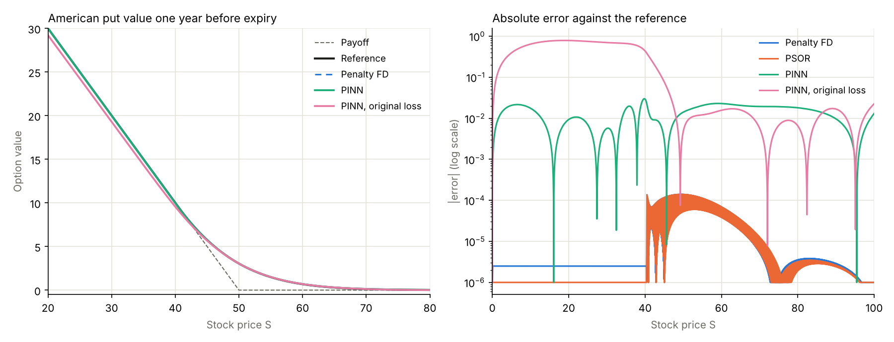
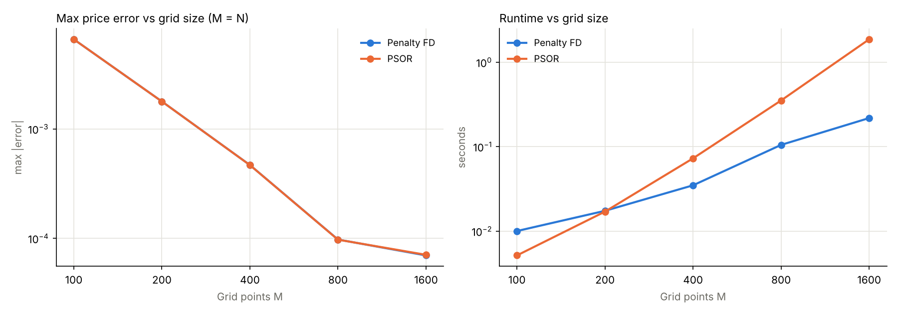
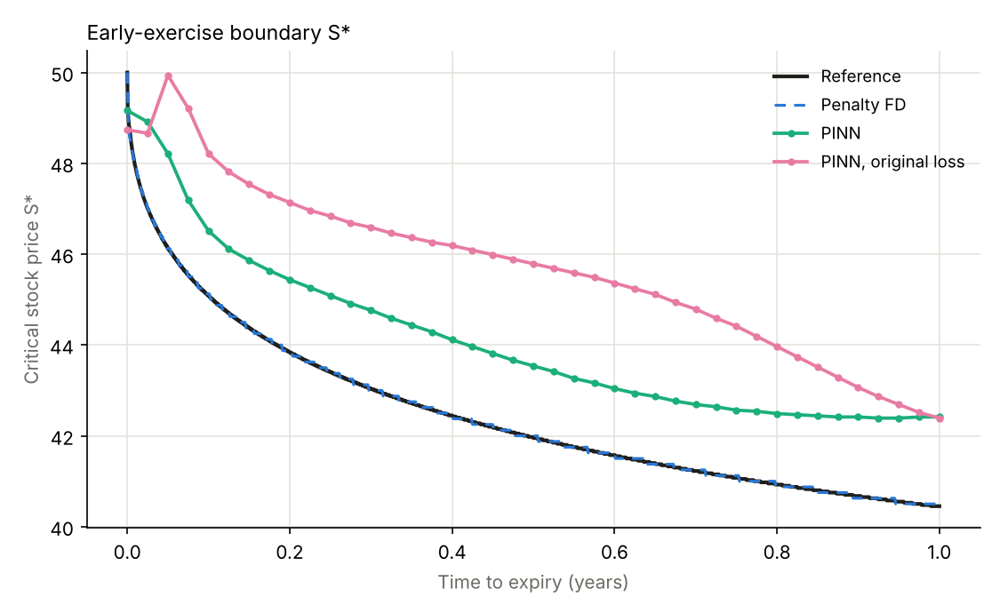
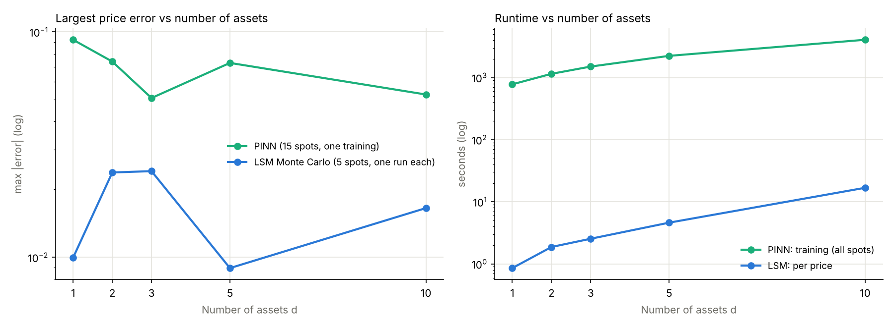
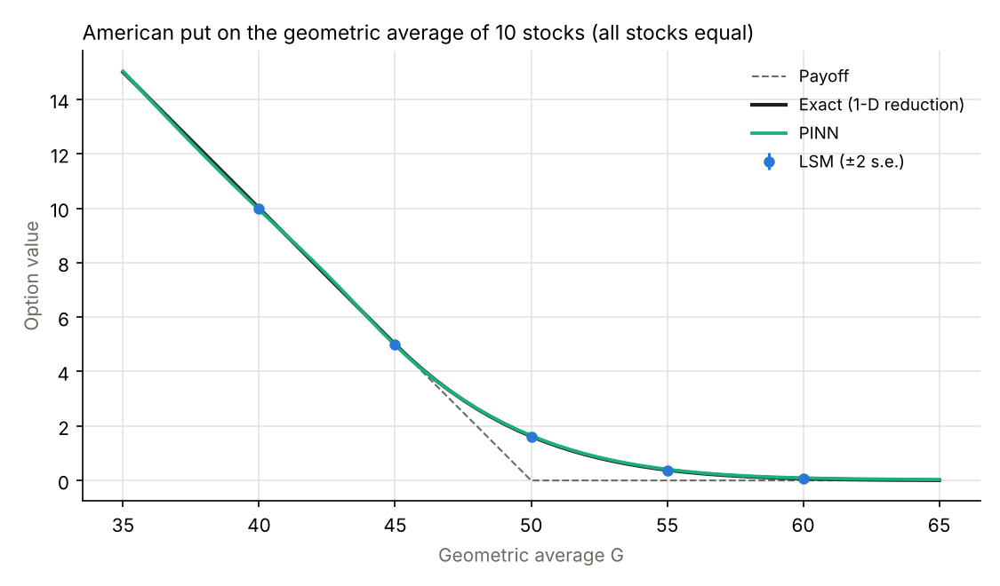

# American Options as Variational Inequalities

This repository is the computational part of my BSc thesis, *Pricing the Risk of Decision Using Variational Inequalities: An American Type Derivatives Example* (Athens University of Economics and Business, Department of Statistics, 2025; supervisor: Professor A. N. Yannacopoulos).

The thesis prices an American put by writing it as a **parabolic variational inequality** (PVI). It then solves the PVI with three methods: a penalty method with finite differences, a projection method (projected SOR) and a physics-informed neural network (PINN). Here each method is implemented and checked against independent reference prices. An **extension**, which goes beyond the thesis, then tests the PINN on the same kind of problem in up to 10 dimensions.

📄 **Thesis (theory, Chapters 1–5):** [`thesis/Dallas_BSc_Dissertation.pdf`](thesis/Dallas_BSc_Dissertation.pdf)

<p align="center">
  
</p>

## Where things are

| Thesis | Topic | In this repository |
|---|---|---|
| Ch. 1 | Elliptic VIs: Lions–Stampacchia, penalization, regularity, free boundary | (theory only) |
| Ch. 2 | Parabolic VIs, Bochner spaces, viscosity solutions | (theory only) |
| Ch. 3 | The American put as a parabolic VI, eqs. (3.11) and (3.14) | the problem solved below |
| Ch. 4 | Penalty method with Crank–Nicolson; projection method and PSOR, eqs. (4.7)–(4.9) | [`pvi/finite_difference.py`](pvi/finite_difference.py) |
| Ch. 5 | PINN with the variational-inequality residual loss, eqs. (5.1)–(5.7) | [`pvi/pinn.py`](pvi/pinn.py) |
| Results | Comparison with reference prices | [`benchmark.py`](benchmark.py), [`results/`](results/) |
| Extension (not in the thesis) | The PINN in 2–10 dimensions, compared with Monte Carlo | [`extension.py`](extension.py), [`pvi/basket.py`](pvi/basket.py), [`results/extension/`](results/extension/) |

## The problem

An American put with strike $K$ can be exercised at any time before maturity $T$. Write $q = T - t$ for the time to expiry and $S$ for the stock price. The value $V(q, S)$ solves the parabolic variational inequality (thesis, eqs. 3.11 and 3.14)

```math
\min\Big\{ \partial_q V + A V,\; V - \psi \Big\} = 0,
\qquad
A V = -\tfrac12\sigma^2 S^2\, \partial_{SS} V - r S\, \partial_S V + r V,
\qquad
\psi(S) = (K - S)^+ ,
```

with $V(0, S) = \psi(S)$, $V(q, 0) = K$ and $V(q, S_{\max}) = 0$.

At every point one of two things holds:
- the Black–Scholes equation holds, which is the continuation region (keep the option); or
- $V = \psi$, which is the exercise region (exercise now).

The two regions are separated by the unknown **early-exercise boundary** $S^\ast(q)$.

**Parameters:** $K = 50$, $r = 5\%$, $\sigma = 20\%$, $T = 1$ year, $S_{\max} = 100$. These are the parameters of the results chapter in the original June 2025 submission.

## Methods

| Method | How the constraint $V \ge \psi$ is enforced | Implementation |
|---|---|---|
| **Penalty FD** (Ch. 4) | Adds $\tfrac{1}{\varepsilon}\min(V - \psi, 0)$ to the equation, with $\varepsilon = 10^{-6}$. The penalty is evaluated at the new time level and solved by Newton (policy) iteration at each step (Forsyth & Vetzal, 2002). | Crank–Nicolson, central differences, tridiagonal solves |
| **PSOR** (Ch. 4) | Each time step is a linear complementarity problem (4.7). It is solved by projected successive over-relaxation (4.8)–(4.9): every SOR update is projected onto $V_i \ge \psi_i$ (Cryer, 1971). | Same discretisation; Young's optimal $\omega$; stops when the largest update is below $10^{-9}$ |
| **PINN** (Ch. 5) | The loss is the residual of the VI itself, $\lVert\min(-\mathcal{B}[u],\, u - \psi)\rVert^2$ (5.3), plus terminal and far-boundary losses. | See the configuration below |
| **Reference** | QuantLib's finite-difference engine on a 4000 × 4000 grid. It is independent of this code and agrees with a fine-grid PSOR solution (4000 × 2000) to $9 \times 10^{-5}$. | [`pvi/reference.py`](pvi/reference.py) |

In both grid methods, the first 4 time steps are fully implicit (Rannacher start-up). This removes the oscillations that Crank–Nicolson produces from the payoff's kink. It is an implementation detail that the thesis does not describe.

**PINN configuration.** These are the values that Section 5.3.4 of the thesis leaves to the repository; they are set in `pvi/pinn.py`.
- **Network:** 4 hidden layers of 64 tanh units. The output layer $u = K e^{-S/S_{\max}} + (1 - e^{-S/S_{\max}}) f_\theta$ (5.4) enforces $u(0, t) = K$ exactly.
- **Loss:** $100\,\mathcal{L}_{\mathrm{VI}} + 50\,\mathcal{L}_{\mathrm{term}} + 50\,\mathcal{L}_{\mathrm{bnd}}$, where $\mathcal{L}_{\mathrm{bnd}} = \overline{(u(0,t) - K)^2} + 0.1\,\overline{u(S_{\max},t)^2}$. The first term of $\mathcal{L}_{\mathrm{bnd}}$ is zero by construction. In the notation of eq. (5.7), this means $\lambda_{\mathrm{term}} = 0.5$ and $\lambda_{\mathrm{far}} = 0.05$.
- **Collocation points:** 4096 interior points, redrawn every 100 iterations.
  - Stock price: half uniform on $[0, S_{\max}]$, half normal around $K$ with standard deviation $0.25K$.
  - Time: half uniform on $[0, T]$, half from a Beta(½, ½) distribution, which puts more points near $t = 0$ and $t = T$.
  - Also 512 terminal points at $t = T$, and 256 boundary times, used at both $S = 0$ and $S = S_{\max}$.
- **Training:** Adam for 20,000 iterations. The learning rate starts at $10^{-3}$ and is divided by 5 after 60% and again after 85% of training.
- **Units:** all quantities are computed in units of $K$ ($S/K$, $u/K$).

**Baselines.** Two further PINNs keep everything above, including the iteration count, schedule and sampling, and change only the interior loss:
- **Original loss:** the loss of the June 2025 submission, $1\cdot\lVert\mathcal{B}[u]\rVert^2 + 10\cdot\lVert(\psi - u)^+\rVert^2 + 30\cdot\lVert(u - \psi)\,\mathcal{B}[u]\rVert^2$.
- **Reweighted:** the same loss with the weights 0.7 / 117 / 97 from an earlier perpetual-put experiment of mine.

Note that the original submission trained for 40,000 iterations, while the baselines here use 20,000. Also, because the loss is computed in units of $K$, the product term scales as $K^4$ and the other terms as $K^2$. The complementarity weight therefore acts like $30/K^2$ of its value in price units.

## Results

The table gives option values one year before expiry. Run `python benchmark.py` to reproduce it; the values are in [`results/prices.csv`](results/prices.csv).

| $S_0$ | Reference | European | Penalty FD | PSOR | PINN (VI residual, Ch. 5) | PINN, original loss | PINN, original loss, reweighted |
|---|---|---|---|---|---|---|---|
| 30 | **20.0000** | 17.5887 | 20.0000 | 20.0000 | 19.9943 | 19.2997 | 19.8937 |
| 40 | **10.0000** | 8.4912 | 10.0000 | 10.0000 | 9.9706 | 9.5624 | 9.9436 |
| 45 | **5.7462** | 5.1071 | 5.7462 | 5.7462 | 5.7432 | 5.6684 | 5.8516 |
| 50 | **3.0451** | 2.7868 | 3.0450 | 3.0450 | 3.0593 | 3.0499 | 3.1386 |
| 55 | **1.4932** | 1.3929 | 1.4931 | 1.4931 | 1.5138 | 1.5053 | 1.5674 |
| 60 | **0.6835** | 0.6460 | 0.6835 | 0.6835 | 0.7064 | 0.6992 | 0.7260 |
| 70 | **0.1216** | 0.1168 | 0.1216 | 0.1216 | 0.1410 | 0.1273 | 0.1325 |
| **max error** | | | **0.0001** | **0.0001** | **0.029** | **0.70** | **0.11** |
| **runtime** | | | **0.11 s** | **0.35 s** | **13 min** | **13 min** | **12 min** |

The grid methods use $M = N = 800$. Their runtimes are from [`results/grid_convergence.csv`](results/grid_convergence.csv). The PINN times are training times. All runtimes depend on the machine. For comparison, QuantLib's 200-step binomial tree, the benchmark of the original submission, is within 0.0027 of the reference.

### 1. The grid methods are accurate and fast

Penalty FD and PSOR agree with the reference to $10^{-4}$ at every price. Each time the grid is doubled, their error falls about fourfold, until it reaches the accuracy of the reference itself. On fine grids the penalty method is the faster of the two. Each Newton step is one tridiagonal solve, and only a few are needed per time step, while PSOR needs more sweeps as the grid is refined.

<p align="center">
  
</p>

### 2. The PINN works, and the form of its loss is what matters

All three PINNs share the architecture, sampling and training of Chapter 5. They differ only in the interior loss.

* **Original loss.** The PDE term $\lVert\mathcal{B}[u]\rVert^2$ asks the Black–Scholes equation to hold everywhere, including the exercise region. There the true solution has $\mathcal{B}[\psi] = -rK \ne 0$, so this term works against the constraint. It pulls the price below the payoff deep in the money: 19.30 at $S = 30$, where exercising immediately gives 20.
* **Reweighted.** Letting the inequality and complementarity terms dominate cuts the error to 0.11, but the price still dips slightly below the payoff deep in the money.
* **VI residual (thesis, eq. 5.3).** This penalises $\min\{-\mathcal{B}[u], u - \psi\}$, which is the variational inequality itself (5.2). It does not force $\mathcal{B}[u] = 0$ in the exercise region, and it brings the error down to 0.03.

In one dimension, however, the PINN does not compete with the grid methods. It is thousands of times slower and much less accurate. Being mesh-free only pays off in higher dimensions, which is what the extension below tests.

### 3. The exercise boundary is harder for the PINN than the price

<p align="center">
  
</p>

The reference boundary one year before expiry is $S^\ast = 40.45$. The grid methods (40.50 and 40.38) recover it to within one grid step ($\Delta S = 0.125$). The PINN's boundary is about 2 units too high (42.4), even though its prices are accurate to 0.03.

The reason is how the value meets the payoff. Near the boundary, $V - \psi \approx \tfrac12\Gamma\,(S - S^\ast)^2$, so a small error in value moves the apparent boundary a long way. The network's boundary is read off the VI itself, as the largest $S < K$ where $u - \psi < -\mathcal{B}[u]$.

## Extension: the PINN in higher dimensions (not part of the thesis)

In one dimension the grid methods are unbeatable. The case for a mesh-free method is that grids stop working when there are several underlying assets. With 200 points per asset and 200 time steps, a grid needs:

| assets $d$ | 1 | 2 | 3 | 5 | 10 |
|---|---|---|---|---|---|
| grid points | $4\times10^{4}$ | $8\times10^{6}$ | $1.6\times10^{9}$ | $6.4\times10^{13}$ | $2\times10^{25}$ |

**Test problem.** An American put on the **geometric average** of $d$ stocks, $G = (S_1 \cdots S_d)^{1/d}$, with payoff $(K - G)^+$. Every stock has volatility 20%, each pair has correlation $\rho = 0.25$, and the other parameters are as above. The geometric average of correlated GBMs is itself a GBM, with

```math
\sigma_G^2 = \sigma^2\,\frac{1 + (d-1)\rho}{d}, \qquad q_G = \tfrac12\left(\sigma^2 - \sigma_G^2\right).
```

So the $d$-dimensional problem has an **exact one-dimensional equivalent**: an American put on $G$ with volatility $\sigma_G$ and dividend yield $q_G$. QuantLib prices that to $10^{-4}$, which gives an exact reference in every dimension. Neither solver uses this shortcut; both work in the full $d$-dimensional space.

**Methods.**
* **PINN.** The same VI-residual loss, written in log-prices $x_i = \ln(S_i/K)$.
  - The $d$-dimensional Black–Scholes operator is computed exactly, through $d$ directional second derivatives.
  - Collocation points (2048 per batch) are drawn around the risk-neutral distribution of the stocks.
  - The network has 4 × 128 tanh units and is trained for 20,000 iterations.
  - It has no boundary-conditioned output layer, so the payoff enters only through the terminal loss.
  - One training run prices every spot.
* **Longstaff–Schwartz Monte Carlo (LSM).** 50 exercise dates, 100,000 training paths and 100,000 independent pricing paths, with a quadratic regression basis plus the payoff. LSM prices a Bermudan option, so its error is measured against the Bermudan reference with the same dates.

**Results.** Run `python extension.py` to reproduce them; the values are in [`results/extension/extension.csv`](results/extension/extension.csv). The PINN is tested on 15 spots: 5 with all stocks equal and 10 with the stocks spread apart. LSM is run at the 5 symmetric spots.

| $d$ | Exact, $G_0 = 50$ | PINN | LSM (± s.e.) | PINN max error | LSM max error | PINN training | LSM per price |
|---|---|---|---|---|---|---|---|
| 1 | 3.0450 | 3.0790 | 3.0392 ± 0.011 | 0.092 | 0.010 | 13 min | 0.9 s |
| 2 | 2.3621 | 2.3944 | 2.3375 ± 0.009 | 0.074 | 0.024 | 19 min | 1.9 s |
| 3 | 2.0844 | 2.1234 | 2.0558 ± 0.008 | 0.051 | 0.024 | 25 min | 2.5 s |
| 5 | 1.8338 | 1.8640 | 1.8205 ± 0.007 | 0.073 | 0.009 | 37 min | 4.6 s |
| 10 | 1.6230 | 1.6468 | 1.6024 ± 0.006 | 0.053 | 0.017 | 68 min | 16.8 s |

<p align="center">
  
</p>
<p align="center">
  
</p>

**What the extension shows:**

* **The PINN solves the 10-dimensional variational inequality, and its accuracy does not degrade with dimension.** Its largest error stays at 0.05–0.09 from $d = 1$ to $d = 10$, which is 2–4% of the at-the-money price. A grid would need $10^{25}$ points for the same problem.
* **Its cost grows roughly linearly, not exponentially.** Training time rises from 13 to 68 minutes, mainly because the second derivatives need one extra backward pass per asset.
* **LSM is still more accurate and much cheaper per price.** Its errors are about 0.01–0.025, at a few seconds per price. The PINN's advantage is that one training run gives the price at *every* spot and time, plus the Greeks by automatic differentiation. At $d = 10$, one PINN training costs about as much as 240 LSM prices, so the PINN pays off when many prices or sensitivities are needed.
* **The payoff must not be built into the network output.** Writing $u = \psi + (1 - t/T) f_\theta$ looks like a natural shortcut, but the network then learns $u = \psi$ with zero loss. The kink of the payoff, where the equation fails, has measure zero and is never sampled. The network has to stay smooth, with the payoff imposed through the loss.

**Limitations.**
* The geometric basket is a convenient benchmark *because* it has a one-dimensional structure. Arithmetic baskets and max-options are harder for every method.
* At $d = 1$ this PINN (error 0.09) is less accurate than the one in the main results (0.03). The main PINN uses the boundary-conditioned output layer of Chapter 5 on a bounded domain, and that layer has no direct $d$-dimensional analogue.
* Each result comes from a single training run on a CPU, with one random seed.

## Relation to the June 2025 submission

The thesis PDF in [`thesis/`](thesis/) is an updated edition of the theoretical part of the thesis submitted in June 2025.
* **This repository replaces** the results chapter and the conclusions of the original submission. The numbers above are the results that go with the thesis.
* **The PINN loss of Chapter 5 was revised.** The original weighted loss is kept here as a baseline, so its effect can be checked directly (Results, section 2).

## Running

```bash
pip install -r requirements.txt
python benchmark.py               # main results, tables and figures (uses the trained PINNs in results/)
python benchmark.py --retrain     # also retrain the three PINNs (~13 min each on a CPU)
python benchmark.py --skip-pinn   # grid methods only
python extension.py               # extension, d = 1..10 (uses the trained networks in results/extension/)
python extension.py --retrain     # retrain them (about 3 hours on a 2-core CPU)
pytest -q                         # tests
```

```python
from pvi.finite_difference import penalty_fd, price_at
res = penalty_fd(K=50, r=0.05, sigma=0.2, T=1.0, S_max=100, M=800, N=800)
price_at(res, 50)        # 3.0450
res["boundary"][-1]      # exercise boundary one year before expiry, ~40.5
```

```
pvi/finite_difference.py   penalty method and projected SOR (Crank–Nicolson, Rannacher start-up)
pvi/pinn.py                PINN: VI-residual loss (Ch. 5), original loss and its reweighted variant
pvi/reference.py           QuantLib reference prices
pvi/basket.py              extension: d-dimensional PINN, LSM Monte Carlo, exact 1-D reference
benchmark.py               main results, writes results/
extension.py               extension, writes results/extension/
results/                   figures, CSV tables, trained network weights
thesis/                    thesis PDF (theory, Chapters 1–5)
tests/                     pytest suite
```

## References

* Tsekrekos, A. E., & Yannacopoulos, A. N. (2024). *Variational Inequalities in Management Science and Finance: Modelling, Analysis, Numerics and Applications*. Springer.
* Kinderlehrer, D., & Stampacchia, G. (1980). *An Introduction to Variational Inequalities and Their Applications*. Academic Press.
* Cryer, C. W. (1971). The solution of a quadratic programming problem using systematic overrelaxation. *SIAM Journal on Control*, 9(3), 385–392.
* Forsyth, P. A., & Vetzal, K. R. (2002). Quadratic convergence for valuing American options using a penalty method. *SIAM Journal on Scientific Computing*, 23(6), 2095–2122.
* Raissi, M., Perdikaris, P., & Karniadakis, G. E. (2019). Physics-informed neural networks. *Journal of Computational Physics*, 378, 686–707.
* Longstaff, F. A., & Schwartz, E. S. (2001). Valuing American options by simulation: a simple least-squares approach. *The Review of Financial Studies*, 14(1), 113–147.

## License

Code: MIT, see [LICENSE](LICENSE). The thesis PDF remains © the author.
